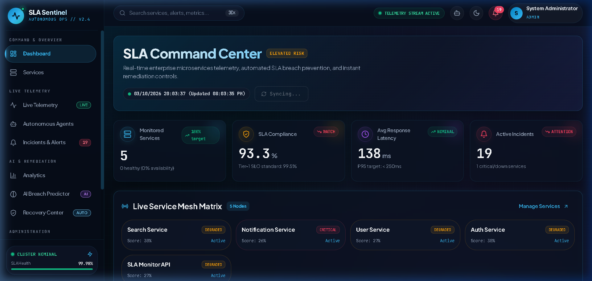
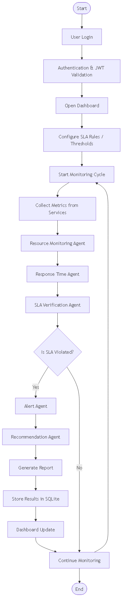
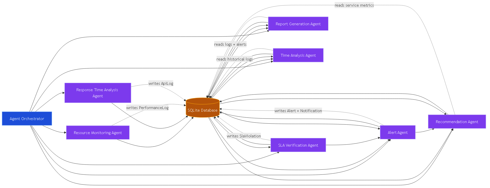
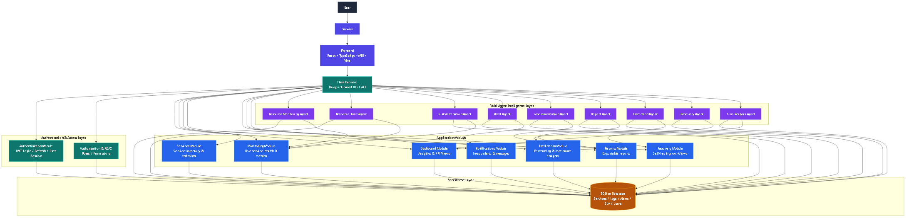

# ⚡ SLA Sentinel — Autonomous Multi-Agent SLA Monitoring System

<div align="center">


**An intelligent, multi-agent observability and automated self-healing platform for enterprise microservices.**  
*Continuous real-time telemetry, predictive AI SLA breach forecasting, dynamic compliance scoring, and autonomous zero-touch remediation.*

[Overview](#-overview) • [How It Works](#-how-it-works) • [System Architecture](#-system-architecture) • [Key Features](#-key-features) • [Quick Start](#-quick-start) • [API Reference](#-api-reference) • [Credentials](#-default-credentials)

</div>

---

## 📸 Dashboard Preview

<div align="center">
  
  <p><em>Real-Time SLA Command Center with Live Service Mesh Matrix, dynamic SLO tracking, and active incident response.</em></p>
</div>

---

## 🔍 How It Works

SLA Sentinel operates as a decentralized, continuous loop powered by **9 specialized background agents**. The system autonomously discovers microservices, monitors real-time performance metrics, detects SLA degradations, forecasts breaches before they occur, and triggers self-healing interventions.

<div align="center">
  
  <p><em>End-to-End System Monitoring, Analysis, Violation Detection, and Self-Healing Cycle.</em></p>
</div>

### Step-by-Step Workflow:

1. **Authentication & Identity**: Operators authenticate with JWT-backed Role-Based Access Control (Admin, Engineer, Viewer).
2. **Autonomous Telemetry Ingestion**: The `ResponseTrackerAgent` and `ResourceMonitorAgent` poll registered microservices and host systems at sub-minute intervals, recording latency, status codes, CPU, RAM, and network throughput.
3. **Continuous SLA Compliance Evaluation**: The `SlaCheckerAgent` measures sliding 24-hour response times, uptime ratios, and error rates against strict tiered SLO agreements.
4. **Predictive Breach Forecasting**: The `PredictionAgent` analyzes latency trends and resource exhaustion vectors using machine learning heuristics, predicting breach probabilities before thresholds are violated.
5. **Instant Alert Generation & Escalation**: When thresholds or anomaly patterns trigger, the `AlertAgent` routes prioritized notifications and incident tickets.
6. **Autonomous Self-Healing**: The `RecoveryAgent` diagnoses root causes and automatically executes remedial protocols (e.g. process container restarts, cache flushes, traffic throttling, circuit breakers) to restore degraded nodes without manual human intervention.
7. **Live Command Center Synchronization**: Telemetry and compliance rates update dynamically on the responsive React dark-mode dashboard.

---

## 🧠 Multi-Agent Architecture

The core of SLA Sentinel is powered by an autonomous multi-agent intelligence layer where agents collaborate independently:

<div align="center">
  
  <p><em>Orchestrated interaction model between background monitoring, analytical, and remediation agents.</em></p>
</div>

| Agent | Responsibility | Interval |
| :--- | :--- | :--- |
| **Response Tracker Agent** | Endpoint probing, HTTP status tracking, latency recording, synthetic demo telemetry | Every 30s |
| **Resource Monitor Agent** | Host hardware metrics (CPU %, RAM %, Disk, Network I/O, process/thread counts) | Every 60s |
| **SLA Checker Agent** | Rolling SLA evaluation, target compliance scoring, breach incident generation | Every 5m |
| **Alert Agent** | Incident threshold alerting, status escalations, multi-channel dispatch | Every 2m |
| **Recovery Agent** | Autonomous self-healing, automatic remediation execution, zero-touch restoration | Every 2m |
| **Prediction Agent** | ML forecasting of SLA breaches, server overload probabilities, confidence scoring | Every 15m |
| **Recommendation Agent** | Optimization advisories, resource re-allocation, architectural suggestions | Every 10m |
| **Time Analyzer Agent** | Peak traffic analysis, load variance, periodic anomaly correlation | Every 5m |
| **Report Agent** | Automated compliance summary compiling, scheduled PDF/CSV/Excel report exports | Every 30m |

---

## 🏛️ System Architecture

<div align="center">
  
  <p><em>Tiered architecture diagram showing Frontend, Flask API, Multi-Agent Engine, and Persistence Layer.</em></p>
</div>

---

## ✨ Key Features

- **Cyber-Mesh Dark Mode UI**: Built with React 18, TypeScript, Vite, Material-UI, Recharts, and Lucide icons.
- **Accurate Real-Time SLA Compliance**: Measures genuine request-level success ratios across rolling 24-hour windows.
- **Live Service Mesh Matrix**: Instant visual health indicator across all microservices (Healthy, Degraded, Critical, Down).
- **AI Breach Prediction Center**: Forecasts potential breaches with probability ratings, predicted response times, and automated root cause analysis.
- **Self-Healing Recovery Center**: Complete log and manual/automatic controls for autonomous remediations.
- **Comprehensive Audit Trail**: Tracks all user actions, agent executions, and configuration changes.
- **Multi-Format Reports**: Export comprehensive audit and SLA compliance logs in PDF, CSV, and Excel.
- **Ready-to-Use Presentation Guide**: Complete architectural and presentation reference guide included in [`docs/SLA_Monitoring_System_Presentation_Guide.pdf`](docs/SLA_Monitoring_System_Presentation_Guide.pdf).

---

## 🚀 Quick Start

### Option 1: One-Click Run (Windows)

Simply double-click [`run-project.bat`](run-project.bat) or execute in terminal:

```cmd
run-project.bat
```

This will automatically:
1. Boot the Flask Backend API daemon on `http://127.0.0.1:5000`
2. Start the Vite React Frontend on `http://localhost:5173`
3. Launch your default browser directly to the SLA Command Center

---

### Option 2: Manual Setup

#### 1. Backend Setup (Flask API)

```bash
cd backend

# Create and activate virtual environment
python -m venv venv
# On Windows:
venv\Scripts\activate
# On Linux/macOS:
# source venv/bin/activate

# Install dependencies
pip install -r requirements.txt

# Run the Flask backend (initializes SQLite DB and starts agents)
python run.py
```

*Backend runs at `http://127.0.0.1:5000`.*

#### 2. Frontend Setup (React + Vite)

```bash
cd frontend

# Install npm dependencies
npm install

# Start development server
npm run dev
```

*Frontend runs at `http://localhost:5173`.*

---

### Option 3: Docker Deployment

```bash
docker-compose up --build -d
```

---

## 🔑 Default Credentials

The platform seeds pre-configured demo operator accounts on first launch:

| Role | Username | Password | Access Level |
| :--- | :--- | :--- | :--- |
| **System Administrator** | `admin` | `Admin@123` | Full access (Configuration, Users, Agents, Recovery) |
| **Platform Engineer** | `engineer` | `Engineer@123` | Operational access (Monitoring, Services, Alerts, Reports) |
| **Auditor / Viewer** | `viewer` | `Viewer@123` | Read-only access (Dashboards, Analytics, Reports) |

*Tip: Click the **"Auto-Fill"** button on the login screen for instant one-click admin sign-in.*

---

## 📡 API Reference Overview

All API endpoints are prefixed with `/api` and secured via JWT Bearer authentication:

| Endpoint | Method | Description |
| :--- | :--- | :--- |
| `/api/auth/login` | `POST` | Authenticate and obtain JWT access token |
| `/api/analytics/dashboard` | `GET` | Real-time KPI statistics, host hardware metrics, SLA compliance |
| `/api/analytics/trends` | `GET` | Historical response times and resource utilization trends |
| `/api/services/` | `GET`, `POST` | Microservice inventory management and configuration |
| `/api/monitoring/live` | `GET` | Live streaming telemetry matrix for active nodes |
| `/api/predictions/` | `GET` | AI breach probabilities and predictive overload analysis |
| `/api/recovery/status` | `GET` | Autonomous self-healing operational state |
| `/api/recovery/auto-heal` | `POST` | Trigger immediate autonomous healing scan across all nodes |
| `/api/alerts/` | `GET` | Active and historical incident alerts |
| `/api/reports/generate` | `POST` | Generate exportable compliance reports (PDF, CSV, Excel) |

---

## 📂 Project Structure

```plaintext
SLA-Monitoring-System/
├── backend/
│   ├── app/
│   │   ├── agents/          # 9 Intelligent Autonomous Background Agents
│   │   ├── models/          # SQLAlchemy Database Models (Services, SLA, Logs, Users)
│   │   ├── routes/          # REST API Endpoints (Auth, Analytics, Recovery, etc.)
│   │   └── utils/           # Database seeders, hardware metrics, JWT helpers
│   ├── config.py            # SQLite & PostgreSQL dynamic configuration
│   ├── requirements.txt     # Python backend dependencies
│   └── run.py               # Backend entrypoint & Agent Orchestrator lifecycle
├── frontend/
│   ├── src/
│   │   ├── components/      # Reusable UI cards, tables, layouts, badges
│   │   ├── context/         # AuthContext and state management
│   │   ├── pages/           # Dashboard, LiveMonitoring, Recovery, Predictions, etc.
│   │   └── services/        # Axios API client configuration
│   ├── package.json         # Node.js dependencies
│   └── vite.config.ts       # Vite build & proxy configuration
├── diagrams/                # Mermaid source definitions & architectural PNGs
├── docs/
│   ├── images/              # High-resolution screenshots & workflow diagrams
│   └── SLA_Monitoring_System_Presentation_Guide.pdf # Presentation guide
├── run-project.bat          # 1-Click Windows startup script
├── docker-compose.yml       # Production container orchestration
└── README.md                # Project documentation
```

---

## 🤝 Contributing

Contributions, feature requests, and issue reports are welcome!  
Feel free to open a pull request or submit an issue to help improve the system.

1. Fork the Project
2. Create your Feature Branch (`git checkout -b feature/AmazingFeature`)
3. Commit your Changes (`git commit -m 'Add some AmazingFeature'`)
4. Push to the Branch (`git push origin feature/AmazingFeature`)
5. Open a Pull Request

---

## 📄 License

Distributed under the **MIT License**. See `LICENSE` for more information.

---

<div align="center">
  Developed by <a href="https://github.com/manojmm22"><strong>@manojmm22</strong></a>
</div>
